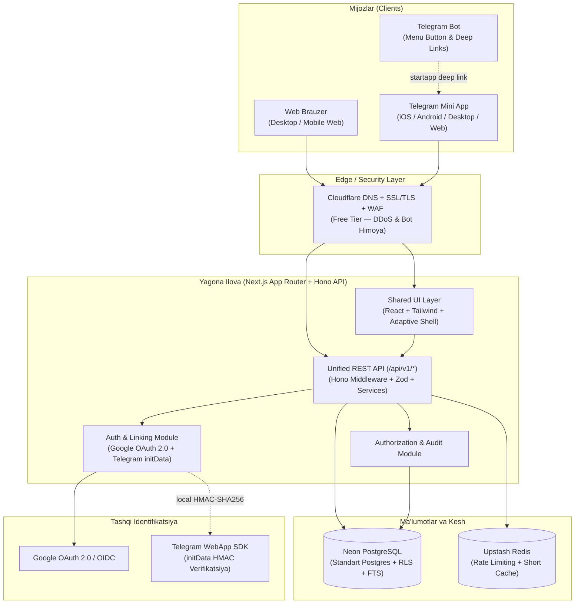

# Texnik Arxitektura (ARCHITECTURE.md)

Ushbu hujjat **Avero** — faqat matnga asoslangan, **Web sayt** va **Telegram Mini App (TMA)** ko‘rinishida ishlaydigan ijtimoiy tarmoqning umumiy texnik arxitekturasini belgilaydi.

---

## 1. Arxitektura Tamoyillari

1. **Modular Monolith (Yagona Backend, Yagona Database):** MVP va o‘rta masshtab bosqichida keraksiz microservice’lardan voz kechiladi. Web va Telegram Mini App bitta backend API va bitta PostgreSQL ma’lumotlar bazasi bilan ishlaydi.
2. **Faqat Matnli Kontent (Text-Only by Design):** Foydalanuvchilar rasm, video yoki fayl yuklay olmaydi. Bu obyekt xotirasi (S3/R2), CDN media xarajatlari va fayl xavfsizligi (malware/CSAM/EXIF) yukini nolga tushiradi hamda tizimni juda tezkor va arzon qiladi.
3. **Bepul Start va Zero Vendor Lock-in:** Barcha dastlabki infratuzilma bepul tariflar (free tier) ustiga quriladi, biroq hech bir pullik yoki yopiq provayderga bog‘lanib qolmaydi (standart PostgreSQL, standart OAuth 2.0, standart REST/HTTP, Docker’ga tayyor Node.js).
4. **Defense-in-Depth (Ko‘p qatlamli xavfsizlik):** Validatsiya, autentifikatsiya, RBAC va PostgreSQL Row Level Security (RLS) birgalikda ishlaydi.
5. **Bosqichma-bosqich Kengayish (Scalable Path):** Ma’lumotlar modeli, cursor pagination va stateless API dizayni 100 ta foydalanuvchidan 1M+ foydalanuvchigacha kodni qaytadan yozmasdan o‘sishga moslashtirilgan.

---

## 2. Yuqori Darajadagi Tizim Diagrammasi



---

## 3. Frontend Arxitekturasi

Frontend **Next.js (App Router, TypeScript, React 19)** va **Tailwind CSS** asosida bitta ilova sifatida quriladi.

### 3.1. Nima uchun bitta Frontend (Web + TMA)?
- **Kod qayta ishlatilishi (90%+):** Feed, Post kartochkasi, Thread (javoblar daraxti), Post yaratish oynasi, Profil, Qidiruv va Sozlamalar komponentlari Web va TMA uchun umumiy bo‘ladi.
- **SEO va Link Preview (OpenGraph):** Matnli ijtimoiy tarmoqda post havolalari Telegram va boshqa platformalarda ulashilganda chiroyli `og:title` va `og:description` ko‘rinishi muhim. Next.js SSR buni tabiiy ta’minlaydi.
- **Yagona domen (Same-Origin):** Web va TMA bitta HTTPS domen ostida ishlaydi (`https://avero.uz`), bu CORS muammolarini kamaytiradi va deploymentni soddalashtiradi.

### 3.2. Adaptive App Shell (Muhitga moslashuv)
Ilova ishga tushganda `PlatformProvider` muhitni aniqlaydi:
- **`web` rejimi:** Yuqori/yon navigatsiya paneli, Google orqali kirish tugmasi, desktop uchun 3 ustunli (Navigatsiya | Feed | Qidiruv/Trendlar) yoki mobil uchun 1 ustunli layout.
- **`telegram` rejimi:** Telegram Mini App muhiti aniqlanganda (`window.Telegram?.WebApp?.initData`):
  - Web navigatsiya sarlavhalari yashiriladi, Telegram’ning nativ `BackButton` va pastki mobil tab-bar ishlatiladi.
  - Telegram `themeParams` ranglari CSS o‘zgaruvchilarga (`--bg-color`, `--text-color`, `--hint-color`, `--button-color`) ulanadi.
  - Telegram `safeAreaInset` va `viewportStableHeight` qiymatlari orqali iOS/Android notch va klaviatura muammolari oldini olinadi.

### 3.3. Client State va Ma’lumot Yuklash
- **Server Components:** Ommaviy sahifalar (post sahifasi, profil sahifasi) birinchi render uchun tez SSR beradi.
- **TanStack Query (React Query):** Feed infinite scroll (cursor pagination), optimistic UI (like, repost, bookmark), kesh invalidatsiyasi.
- **Matnli Avatarlar (Zero Media):** Foydalanuvchilar rasm yuklamagani sababli avatarlar foydalanuvchi `username` va `id` xeshiga asoslangan deterministik rangli monogramma (SVG/CSS) sifatida generatsiya qilinadi.

---

## 4. Telegram Mini App (TMA) Arxitekturasi

Telegram Mini App alohida loyiha emas, balki asosiy ilovaning TMA-moslashgan rejimi hisoblanadi.

### 4.1. Ishga tushirish (Bootstrap) oqimi
1. Foydalanuvchi Telegram Bot’dagi Menu Button yoki `https://t.me/<bot>/<app>?startapp=...` havolasini bosadi.
2. Ilova yuklanadi, `@telegram-apps/sdk` (yoki rasmiy `telegram-web-app.js`) orqali `WebApp.ready()` va `WebApp.expand()` chaqiriladi.
3. Agar foydalanuvchida faol sessiya tokeni bo‘lmasa, frontend `window.Telegram.WebApp.initData` (xom query string) ni `POST /api/v1/auth/telegram` ga yuboradi.
4. Backend `initData` imzosini HMAC-SHA256 orqali tekshiradi, foydalanuvchini topadi yoki yangi profil yaratadi va qisqa/o‘rta muddatli opaque **Bearer sessiya tokeni** qaytaradi.
5. Frontend tokenni xotirada va `sessionStorage` da saqlaydi va keyingi barcha API so‘rovlariga `Authorization: Bearer <token>` sarlavhasi bilan yuboradi.

> **Muhim texnik qaror:** Telegram iOS `WKWebView` va Telegram Web `iframe` muhitlarida third-party cookie’lar ko‘pincha bloklanadi. Shu sababli Web sessiyalar uchun `HttpOnly; Secure; SameSite=Lax` cookie, TMA uchun esa `Authorization: Bearer` token ishlatiladi. Ikkalasi ham backend’da bitta `user_sessions` jadvali orqali boshqariladi.

### 4.2. Deep Linking (`startapp`)
Telegram Mini App’ga parametr uzatish `startapp` orqali amalga oshiriladi:
- `startapp=post_<postId>` → Post sahifasini to‘g‘ridan-to‘g‘ri ochish.
- `startapp=u_<username>` → Foydalanuvchi profilini ochish.
- `startapp=link_<oneTimeToken>` → Web (Google) akkauntga Telegram’ni xavfsiz bog‘lash oqimini yakunlash.

### 4.3. Telegram’dan Google’ga ulanish (External Browser)
Google OAuth 2.0 xavfsizlik qoidalariga ko‘ra embedded WebView ichida ishlashni taqiqlaydi (`403 disallowed_useragent`). Shu sababli TMA ichida "Google ulash" tugmasi bosilganda:
1. Backend bir martalik `link_token` yaratadi.
2. TMA `WebApp.openLink('https://<domain>/auth/link/google?token=...')` orqali tizim brauzerini (Chrome/Safari) ochadi.
3. Foydalanuvchi tizim brauzerida Google OAuth’dan o‘tadi, bog‘lash yakunlanadi va TMA’ga qaytadi.

---

## 5. Backend Arxitekturasi

Backend Next.js ilovasi ichida **`/api/v1/[[...route]]`** marshrutiga ulangan **Hono** (yengil, standart Web Fetch API asosidagi router) orqali yagona Modular Monolith sifatida ishlaydi.

### 5.1. Nima uchun Next.js ichida Hono?
- **Yagona server va bitta deploy:** Alohida backend server sotib olish yoki ikki joyga deploy qilish shart emas.
- **Toza Middleware zanjiri:** Request ID, structured logging, security headers, CORS, Content-Type/Body-size tekshiruvi, rate limiting, auth sessiya tekshiruvi, RBAC va markazlashgan error handler bitta joyda ishlaydi.
- **Portativlik (Lock-in yo‘q):** Kelajakda trafik oshib API’ni alohida serverga ajratish kerak bo‘lsa, `src/server/api` papkasini deyarli o‘zgartirishsiz alohida Node.js / Bun / Cloudflare Worker xizmatiga ko‘chirish mumkin.

### 5.2. Qatlamli (Layered) Tuzilma
```text
HTTP Request
   │
   ▼
[1. API / Middleware Layer]  ── Request ID, Rate Limit, JSON-only (max 16KB), Auth Session
   │
   ▼
[2. Validation Layer (Zod)]  ── Schema tekshiruvi, Unicode normalizatsiya, uzunlik cheklovlari
   │
   ▼
[3. Service Layer]           ── Biznes mantiq, RBAC tekshiruvi, Audit Log yozish
   │
   ▼
[4. Repository / DB Layer]   ── Drizzle ORM + withDbContext (PostgreSQL RLS tranzaksiyasi)
   │
   ▼
PostgreSQL (RLS Enforced)
```

---

## 6. API Tuzilishi (`/api/v1`)

Barcha endpointlar **REST** uslubida, faqat `application/json` formatida ishlaydi.

### 6.1. Standart Javob Formati
**Muvaffaqiyatli javob:**
```json
{
  "ok": true,
  "data": { "...": "..." },
  "meta": {
    "nextCursor": "eyJjcmVhdGVkQXQiOi...",
    "requestId": "req_01J..."
  }
}
```

**Xato javobi:**
```json
{
  "ok": false,
  "error": {
    "code": "RATE_LIMIT_EXCEEDED",
    "message": "Juda ko'p so'rov yuborildi. Birozdan so'ng urinib ko'ring.",
    "details": {}
  },
  "meta": {
    "requestId": "req_01J..."
  }
}
```

### 6.2. Asosiy Endpointlar Ro‘yxati

#### Autentifikatsiya va Akkaunt Bog‘lash
| Metod | Endpoint | Tavsif | Ruxsat |
| :--- | :--- | :--- | :--- |
| `GET` | `/api/v1/auth/google/start` | Google OAuth 2.0 + PKCE login boshlash | Public |
| `GET` | `/api/v1/auth/google/callback` | Google callback, sessiya yaratish yoki bog‘lash | Public |
| `POST` | `/api/v1/auth/telegram` | Telegram `initData` tekshirish va sessiya yaratish | Public |
| `GET` | `/api/v1/auth/me` | Joriy foydalanuvchi profili va bog‘langan provayderlar | Auth |
| `POST` | `/api/v1/auth/logout` | Joriy sessiyani bekor qilish | Auth |
| `POST` | `/api/v1/auth/logout-all` | Barcha qurilmalardagi sessiyalarni yopish | Auth |
| `POST` | `/api/v1/auth/link/telegram/init` | Web’dan Telegram ulash uchun 1 martalik token olish | Auth |
| `POST` | `/api/v1/auth/link/telegram/confirm` | TMA `initData` + token orqali bog‘lashni tasdiqlash | Public (Token+initData) |
| `POST` | `/api/v1/auth/link/google/init` | TMA’dan Google ulash uchun 1 martalik token olish | Auth |
| `DELETE` | `/api/v1/auth/identities/:provider` | Provayderni uzish (kamida 2 ta provayder bo‘lsa) | Auth |

#### Foydalanuvchilar va Obunalar
| Metod | Endpoint | Tavsif | Ruxsat |
| :--- | :--- | :--- | :--- |
| `GET` | `/api/v1/users/:username` | Ommaviy profil va statistika | Public/Auth |
| `PATCH` | `/api/v1/users/me` | Profil tahrirlash (`username`, `displayName`, `bio`) | Auth |
| `POST` | `/api/v1/users/:id/follow` | Obuna bo‘lish | Auth |
| `DELETE` | `/api/v1/users/:id/follow` | Obunani bekor qilish | Auth |
| `GET` | `/api/v1/users/:username/followers` | Obunachilar ro‘yxati (cursor pagination) | Public/Auth |
| `GET` | `/api/v1/users/:username/following` | Kuzatilayotganlar ro‘yxati | Public/Auth |
| `POST` | `/api/v1/users/:id/block` | Foydalanuvchini bloklash | Auth |
| `DELETE` | `/api/v1/users/:id/block` | Blokdan chiqarish | Auth |

#### Postlar, Thread’lar, Lenta va Qidiruv
| Metod | Endpoint | Tavsif | Ruxsat |
| :--- | :--- | :--- | :--- |
| `GET` | `/api/v1/feed` | Lenta (`tab=latest\|following`, `cursor`, `limit`) | Public/Auth |
| `POST` | `/api/v1/posts` | Yangi matnli post yoki javob (`replyToId`) yaratish | Auth |
| `GET` | `/api/v1/posts/:id` | Post tafsilotlari | Public/Auth |
| `GET` | `/api/v1/posts/:id/replies` | Postga javoblar (cursor pagination) | Public/Auth |
| `DELETE` | `/api/v1/posts/:id` | Postni o‘chirish (soft delete) | Owner / Mod / Admin |
| `POST` | `/api/v1/posts/:id/like` | Like bosish (idempotent) | Auth |
| `DELETE` | `/api/v1/posts/:id/like` | Like olib tashlash | Auth |
| `POST` | `/api/v1/posts/:id/repost` | Repost qilish | Auth |
| `DELETE` | `/api/v1/posts/:id/repost` | Repostni bekor qilish | Auth |
| `POST` | `/api/v1/posts/:id/bookmark` | Saqlash (bookmark) | Auth |
| `DELETE` | `/api/v1/posts/:id/bookmark` | Saqlanganlardan o‘chirish | Auth |
| `GET` | `/api/v1/bookmarks` | Mening saqlangan postlarim | Auth |
| `GET` | `/api/v1/search` | Matn va foydalanuvchi qidiruvi (`q`, `type=posts\|users`) | Public/Auth |

#### Shikoyatlar, Moderatsiya va Admin
| Metod | Endpoint | Tavsif | Ruxsat |
| :--- | :--- | :--- | :--- |
| `POST` | `/api/v1/reports` | Post yoki foydalanuvchi ustidan shikoyat yuborish | Auth |
| `GET` | `/api/v1/mod/reports` | Shikoyatlar navbati | Moderator / Admin |
| `POST` | `/api/v1/mod/reports/:id/resolve` | Shikoyat bo‘yicha qaror qabul qilish | Moderator / Admin |
| `POST` | `/api/v1/mod/posts/:id/hide` | Postni yashirish / tiklash | Moderator / Admin |
| `POST` | `/api/v1/mod/users/:id/suspend` | Foydalanuvchini vaqtincha bloklash | Moderator / Admin |
| `PATCH` | `/api/v1/admin/users/:id/role` | Foydalanuvchi rolini o‘zgartirish (`user`/`moderator`) | Admin |
| `GET` | `/api/v1/admin/audit-logs` | Xavfsizlik va moderatsiya audit loglari | Admin |
| `GET` | `/api/v1/health` | Tizim va DB sog‘lig‘ini tekshirish | Public |

---

## 7. Deployment Arxitekturasi va Kengayish Rejasi

Telegram Mini App faqat **HTTPS** manzilni qabul qiladi.

### 7.1. Bosqich 1 — MVP (0 – 10,000 MAU | $0/oy)
- **DNS, SSL va WAF:** Cloudflare Free (TLS 1.3, DDoS himoya, bot filtering).
- **Ilova Hostingi (2 ta bepul variant — litsenziya shartiga qarab):**
  - *Tijoriy foydalanishga ruxsat etilgan bepul variant:* **Cloudflare Workers (OpenNext adapter)** yoki **Render Free** (750 soat/oy, custom domain bor, lekin 15 daqiqa harakatsizlikda uxlaydi).
  - *Shaxsiy / notijoriy MVP test bosqichida:* **Vercel Hobby** (0$, 100 GB trafik, Next.js uchun eng silliq DX — faqat tijoriy maqsadda ishlatilganda Pro yoki Cloudflare/VPS ga o‘tiladi).
- **Ma’lumotlar bazasi:** **Neon PostgreSQL Free Tier** (1 GB xotira, 100 CU-soat/oy, 10 ta branch, avtomatik scale-to-zero).
- **Rate Limiting / Kesh:** **Upstash Redis Free Tier** (500,000 komanda/oy, kredit karta talab qilinmaydi).
- **Xatoliklarni kuzatish:** **Sentry Free Tier** (5,000 error/oy).

### 7.2. Bosqich 2 — O‘sish (10,000 – 100,000 MAU | ~$10–$25/oy)
- Ilovani `Dockerfile` (`output: 'standalone'`) orqali arzon VPS (Hetzner / DigitalOcean, $5–$10/oy) yoki Cloudflare Workers Paid ($5/oy) ga ko‘chirish — **kodni o‘zgartirmasdan**.
- Neon Launch / Managed PostgreSQL + Connection Pooling (PgBouncer).
- Redis’da ommaviy feed va profillarni qisqa muddatli keshlash (15–60 soniya).

### 7.3. Bosqich 3 — Katta Masshtab (100,000 – 1M+ MAU)
- PostgreSQL **Read Replicas** (o‘qish so‘rovlarini replikalarga yo‘naltirish).
- **Hybrid Fan-out Feed:** Oddiy foydalanuvchilar uchun background worker (BullMQ / pg-boss) orqali feed pre-compute, 10K+ obunachili akkauntlar uchun fan-out-on-read.
- `posts` va `audit_logs` jadvallarini vaqt bo‘yicha **Declarative Partitioning** qilish.
- Agar PostgreSQL FTS yetarli bo‘lmasa, Meilisearch/Typesense qidiruv servisini qo‘shish.

---

## 8. Environment Variables (Muhit O‘zgaruvchilari)

Hech qanday kalit yoki parol Git repository’ga yozilmaydi. Repository’da faqat bo‘sh shablon `.env.example` saqlanadi.

| O‘zgaruvchi | Turi | Majburiyligi | Tavsif |
| :--- | :--- | :--- | :--- |
| `NODE_ENV` | Server | Ha | `development` / `test` / `production` |
| `APP_URL` | Server | Ha | Asosiy HTTPS domen (masalan, `https://avero.uz`) |
| `NEXT_PUBLIC_APP_URL` | Public | Ha | Client uchun ommaviy domen |
| `NEXT_PUBLIC_TELEGRAM_BOT_USERNAME` | Public | Ha | Deep-link generatsiyasi uchun bot username |
| `NEXT_PUBLIC_TELEGRAM_APP_SHORT_NAME` | Public | Ha | Telegram Mini App short name (`startapp` uchun) |
| `DATABASE_URL` | Server (Secret) | Ha | `avero_app` roli bilan pooled PostgreSQL ulanish manzili |
| `DATABASE_MIGRATION_URL` | Server (Secret) | Migratsiya | `avero_migrator` roli bilan direct ulanish (faqat migratsiya uchun) |
| `AUTH_SESSION_SECRET` | Server (Secret) | Ha | OAuth `state` va CSRF tokenlarni imzolash uchun 32+ baytlik tasodifiy kalit |
| `GOOGLE_CLIENT_ID` | Server | Ha | Google Cloud Console OAuth 2.0 Client ID |
| `GOOGLE_CLIENT_SECRET` | Server (Secret) | Ha | Google OAuth 2.0 Client Secret |
| `TELEGRAM_BOT_TOKEN` | Server (Secret) | Ha | Telegram `initData` HMAC-SHA256 tekshiruvi uchun Bot tokeni |
| `UPSTASH_REDIS_REST_URL` | Server (Secret) | Tavsiya | Upstash Redis REST endpoint (yo‘q bo‘lsa lokal fallback ishlaydi) |
| `UPSTASH_REDIS_REST_TOKEN` | Server (Secret) | Tavsiya | Upstash Redis REST tokeni |
| `AUDIT_IP_SALT` | Server (Secret) | Ha | IP manzillarni audit logda xeshlash uchun maxfiy salt |
| `SENTRY_DSN` | Server/Public | Ixtiyoriy | Xatolarni monitoring qilish uchun DSN |

---

## 9. Papkalar va Fayllar Tuzilishi

```text
c:\avero\
├── docs/                              # Texnik va arxitektura hujjatlari
│   ├── ARCHITECTURE.md
│   ├── DATABASE_SCHEMA.md
│   ├── SECURITY.md
│   ├── TECH_STACK.md
│   └── DEVELOPMENT_ROADMAP.md
├── drizzle/                           # SQL migratsiyalar va RLS policy fayllari
│   ├── 0000_initial_schema.sql
│   ├── 0001_rls_policies.sql
│   └── meta/
├── src/
│   ├── app/                           # Next.js App Router sahifalari
│   │   ├── layout.tsx                 # Root layout + PlatformProvider (Web/TMA)
│   │   ├── globals.css                # Tailwind + Telegram theme variables
│   │   ├── (public)/                  # Umumiy sahifalar (Feed, Post, Profile, Search)
│   │   │   ├── page.tsx               # Asosiy lenta
│   │   │   ├── p/[id]/page.tsx        # Post va javoblar (Thread)
│   │   │   ├── u/[username]/page.tsx  # Foydalanuvchi profili
│   │   │   └── search/page.tsx        # Qidiruv
│   │   ├── (auth)/                    # Auth va bog‘lash sahifalari
│   │   │   ├── login/page.tsx
│   │   │   └── auth/link/google/page.tsx
│   │   ├── (protected)/               # Kirish talab qiluvchi sahifalar
│   │   │   ├── settings/page.tsx      # Profil va bog‘langan akkauntlar
│   │   │   ├── bookmarks/page.tsx
│   │   │   └── notifications/page.tsx
│   │   ├── (staff)/                   # Moderator va Admin paneli
│   │   │   ├── mod/page.tsx           # Shikoyatlar navbati
│   │   │   └── admin/page.tsx         # Rollar va audit loglar
│   │   └── api/
│   │       └── v1/
│   │           └── [[...route]]/
│   │               └── route.ts       # Hono Unified API kirish nuqtasi
│   ├── components/                    # Umumiy React komponentlar
│   │   ├── shell/                     # WebShell, TelegramShell, BottomNav
│   │   ├── posts/                     # PostCard, PostComposer, ThreadList
│   │   ├── profile/                   # ProfileHeader, TextAvatar, FollowButton
│   │   ├── auth/                      # GoogleLoginButton, AccountLinkingCard
│   │   └── ui/                        # Tugma, Modal, Dialog, Skeleton
│   ├── lib/                           # Client & shared yordamchilar
│   │   ├── telegram/                  # TMA SDK wrapper, theme sync, startapp parser
│   │   ├── api-client.ts              # Typed fetch wrapper (cookie/bearer)
│   │   ├── env.ts                     # Zod orqali env validatsiyasi
│   │   └── validation/                # Client va Server umumiy Zod sxemalari
│   └── server/                        # Faqat serverda ishlaydigan kod (`server-only`)
│       ├── api/                       # Hono app, marshrutlar va middleware
│       │   ├── app.ts
│       │   ├── middleware/            # auth, rate-limit, rbac, json-only, error
│       │   └── routes/                # auth, users, posts, feed, search, mod, admin
│       ├── auth/                      # Google OAuth, Telegram HMAC, Session, Linking
│       ├── db/
│       │   ├── index.ts               # Drizzle client + pool
│       │   ├── context.ts             # withDbContext() — PostgreSQL RLS wrapper
│       │   └── schema/                # Drizzle jadvallar ta’rifi
│       ├── services/                  # Biznes mantiq (post, feed, user, moderation, audit)
│       └── security/                  # RateLimiter (Upstash + fallback), text sanitizer
├── tests/                             # Unit, integration va security testlar
│   ├── unit/
│   └── integration/
├── .env.example
├── .gitignore
├── drizzle.config.ts
├── next.config.ts
├── package.json
└── tsconfig.json
```
