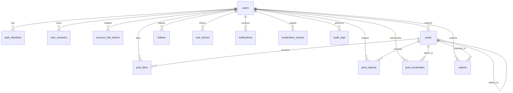

# Ma’lumotlar Bazasi Sxemasi va RLS (DATABASE_SCHEMA.md)

Ushbu hujjat **Avero** loyihasining PostgreSQL ma’lumotlar bazasi dizayni, indekslash strategiyasi, sig‘im hisob-kitobi va **Row Level Security (RLS)** qoidalarini belgilaydi.

---

## 1. Database va ORM Tanlovi

- **DBMS:** **PostgreSQL 16+** (boshlang‘ich hosting: **Neon Free Tier** — 1 GB storage, 100 CU-soat/oy, avtomatik scale-to-zero).
- **ORM / Migratsiya:** **Drizzle ORM** + **Drizzle Kit** (yengil ~7.4 KB, native binary yo‘q, SQL migratsiyalar va PostgreSQL RLS bilan to‘liq mos).
- **Nima uchun PostgreSQL?**
  1. Nativ **Row Level Security (RLS)** — ma’lumotlar xavfsizligini DB darajasida kafolatlaydi.
  2. Nativ **Full-Text Search (`tsvector` + GIN + `pg_trgm`)** — qo‘shimcha pullik qidiruv servislarisiz matn va username qidiruvi.
  3. **ACID tranzaksiyalar** — Google/Telegram akkaunt bog‘lash, bir martalik tokenlarni sarflash va hisoblagichlarni xavfsiz yangilash uchun.
  4. **Zero Lock-in** — Neon’dan Supabase, AWS RDS yoki o‘z VPS PostgreSQL’ga istalgan paytda ko‘chirish mumkin.

---

## 2. Entity-Relationship (ER) Diagramma



---

## 3. Jadvallar Ta’rifi

Barcha identifikatorlar uchun `uuid` (UUIDv7 yoki `gen_random_uuid()`) ishlatiladi — bu ketma-ket integer ID orqali foydalanuvchi/post sonini taxmin qilish (enumeration) xavfini kamaytiradi.

### 3.1. `users` — Asosiy Foydalanuvchi Profillari
| Ustun | Tip | Cheklovlar | Tavsif |
| :--- | :--- | :--- | :--- |
| `id` | `uuid` | `PK, DEFAULT gen_random_uuid()` | Yagona foydalanuvchi ID |
| `username` | `varchar(30)` | `NOT NULL, UNIQUE` (case-insensitive index) | Lotin harf, raqam, `_` (`^[a-z0-9_]{3,30}$`) |
| `display_name` | `varchar(60)` | `NOT NULL` | Ko‘rinadigan ism |
| `bio` | `varchar(160)` | `NOT NULL DEFAULT ''` | Faqat matnli qisqa tavsif |
| `role` | `user_role` | `NOT NULL DEFAULT 'user'` | Enum: `'user'`, `'moderator'`, `'admin'` |
| `status` | `user_status` | `NOT NULL DEFAULT 'active'` | Enum: `'active'`, `'muted'`, `'suspended'`, `'banned'` |
| `suspended_until` | `timestamptz` | `NULL` | Vaqtincha bloklash tugash vaqti |
| `followers_count` | `integer` | `NOT NULL DEFAULT 0, CHECK >= 0` | Denormalizatsiyalangan hisoblagich |
| `following_count` | `integer` | `NOT NULL DEFAULT 0, CHECK >= 0` | Denormalizatsiyalangan hisoblagich |
| `posts_count` | `integer` | `NOT NULL DEFAULT 0, CHECK >= 0` | Denormalizatsiyalangan hisoblagich |
| `created_at` | `timestamptz` | `NOT NULL DEFAULT now()` | Ro‘yxatdan o‘tgan vaqt |
| `updated_at` | `timestamptz` | `NOT NULL DEFAULT now()` | Oxirgi tahrir vaqti |

> **Text-Only Eslatma:** `users` jadvalida `avatar_url`, `banner_url` yoki media ustunlari **mavjud emas**.

### 3.2. `auth_identities` — Google va Telegram Akkaunt Bog‘lanishlari
| Ustun | Tip | Cheklovlar | Tavsif |
| :--- | :--- | :--- | :--- |
| `id` | `uuid` | `PK` | Yozuv ID |
| `user_id` | `uuid` | `FK -> users(id) ON DELETE CASCADE, NOT NULL` | Qaysi profilga tegishli |
| `provider` | `auth_provider` | `NOT NULL` | Enum: `'google'`, `'telegram'` |
| `provider_user_id` | `varchar(128)` | `NOT NULL` | Google `sub` yoki Telegram numeric `user.id` |
| `provider_email` | `varchar(255)` | `NULL` | Google email (faqat `email_verified = true` bo‘lsa) |
| `provider_username` | `varchar(64)` | `NULL` | Telegram `@username` (ma’lumot uchun) |
| `email_verified` | `boolean` | `NOT NULL DEFAULT false` | Google email tasdiqlanganligi |
| `linked_at` | `timestamptz` | `NOT NULL DEFAULT now()` | Bog‘langan vaqt |
| `last_login_at` | `timestamptz` | `NULL` | Oxirgi kirish vaqti |

**Kritik Unique Cheklovlar:**
- `UNIQUE (provider, provider_user_id)` — Bitta Google yoki Telegram akkaunt hech qachon ikki profilga ulana olmaydi.
- `UNIQUE (user_id, provider)` — Bitta profilga ko‘pi bilan bitta Google va bitta Telegram ulanadi.

### 3.3. `user_sessions` — Opaque Sessiyalar
| Ustun | Tip | Cheklovlar | Tavsif |
| :--- | :--- | :--- | :--- |
| `id` | `uuid` | `PK` | Sessiya ID |
| `user_id` | `uuid` | `FK -> users(id) ON DELETE CASCADE, NOT NULL` | Foydalanuvchi ID |
| `token_hash` | `char(64)` | `NOT NULL, UNIQUE` | Sessiya tokenining SHA-256 xeshi (plaintext saqlanmaydi) |
| `auth_channel` | `varchar(16)` | `NOT NULL` | `'web_cookie'` yoki `'tma_bearer'` |
| `provider` | `auth_provider` | `NOT NULL` | Qaysi provayder orqali ochilgan |
| `ip_hash` | `char(64)` | `NULL` | Salt bilan xeshlangan IP |
| `user_agent` | `varchar(255)` | `NULL` | Qisqartirilgan User-Agent |
| `expires_at` | `timestamptz` | `NOT NULL` | Tugash vaqti |
| `revoked_at` | `timestamptz` | `NULL` | Bekor qilingan vaqt |
| `last_seen_at` | `timestamptz` | `NOT NULL DEFAULT now()` | Oxirgi faollik |
| `created_at` | `timestamptz` | `NOT NULL DEFAULT now()` | Yaratilgan vaqt |

### 3.4. `account_link_tokens` — Bir Martalik Bog‘lash Tokenlari
| Ustun | Tip | Cheklovlar | Tavsif |
| :--- | :--- | :--- | :--- |
| `id` | `uuid` | `PK` | Token ID |
| `user_id` | `uuid` | `FK -> users(id) ON DELETE CASCADE, NOT NULL` | Bog‘lashni boshlagan foydalanuvchi |
| `target_provider` | `auth_provider` | `NOT NULL` | Ulanishi kutilayotgan provayder (`'google'` / `'telegram'`) |
| `token_hash` | `char(64)` | `NOT NULL, UNIQUE` | Tasodifiy tokenning SHA-256 xeshi |
| `ip_hash` | `char(64)` | `NULL` | Boshlagan IP xeshi |
| `expires_at` | `timestamptz` | `NOT NULL` | Qisqa muddat (5 daqiqa) |
| `used_at` | `timestamptz` | `NULL` | Ishlatilgan vaqt (atomik tekshiruv) |
| `created_at` | `timestamptz` | `NOT NULL DEFAULT now()` | Yaratilgan vaqt |

### 3.5. `posts` — Faqat Matnli Postlar va Javoblar (Threads)
| Ustun | Tip | Cheklovlar | Tavsif |
| :--- | :--- | :--- | :--- |
| `id` | `uuid` | `PK` | Post ID |
| `author_id` | `uuid` | `FK -> users(id) ON DELETE CASCADE, NOT NULL` | Muallif |
| `body` | `text` | `NOT NULL, CHECK (char_length(trim(body)) BETWEEN 1 AND 500)` | Faqat matn (1–500 belgi) |
| `reply_to_id` | `uuid` | `FK -> posts(id) ON DELETE SET NULL, NULL` | Bevosita javob berilgan post |
| `root_post_id` | `uuid` | `FK -> posts(id) ON DELETE SET NULL, NULL` | Thread boshi (tezkor thread yuklash uchun) |
| `moderation_status` | `varchar(16)` | `NOT NULL DEFAULT 'active'` | `'active'`, `'hidden'`, `'removed'` |
| `likes_count` | `integer` | `NOT NULL DEFAULT 0, CHECK >= 0` | Like soni |
| `replies_count` | `integer` | `NOT NULL DEFAULT 0, CHECK >= 0` | Javoblar soni |
| `reposts_count` | `integer` | `NOT NULL DEFAULT 0, CHECK >= 0` | Repost soni |
| `search_vector` | `tsvector` | `GENERATED ALWAYS AS (to_tsvector('simple', body)) STORED` | Full-text search indeksi (o‘zbek/lotin/kirill uchun `'simple'`) |
| `created_at` | `timestamptz` | `NOT NULL DEFAULT now()` | Yaratilgan vaqt |
| `deleted_at` | `timestamptz` | `NULL` | Soft delete vaqti |

### 3.6. O‘zaro Aloqalar (Interactions & Social Graph)

- **`post_likes`:** `(user_id uuid FK, post_id uuid FK, created_at timestamptz)` — `PRIMARY KEY (user_id, post_id)`
- **`post_reposts`:** `(user_id uuid FK, post_id uuid FK, created_at timestamptz)` — `PRIMARY KEY (user_id, post_id)`
- **`post_bookmarks`:** `(user_id uuid FK, post_id uuid FK, created_at timestamptz)` — `PRIMARY KEY (user_id, post_id)`
- **`follows`:** `(follower_id uuid FK, following_id uuid FK, created_at timestamptz)` — `PRIMARY KEY (follower_id, following_id)`, `CHECK (follower_id <> following_id)`
- **`user_blocks`:** `(blocker_id uuid FK, blocked_id uuid FK, created_at timestamptz)` — `PRIMARY KEY (blocker_id, blocked_id)`, `CHECK (blocker_id <> blocked_id)`

### 3.7. `notifications` — Bildirishnomalar
| Ustun | Tip | Cheklovlar | Tavsif |
| :--- | :--- | :--- | :--- |
| `id` | `uuid` | `PK` | ID |
| `recipient_id` | `uuid` | `FK -> users(id) ON DELETE CASCADE, NOT NULL` | Qabul qiluvchi |
| `actor_id` | `uuid` | `FK -> users(id) ON DELETE CASCADE, NOT NULL` | Harakat qiluvchi |
| `type` | `varchar(24)` | `NOT NULL` | `'reply'`, `'like'`, `'repost'`, `'follow'`, `'mention'`, `'system'` |
| `post_id` | `uuid` | `FK -> posts(id) ON DELETE CASCADE, NULL` | Bog‘liq post (agar bo‘lsa) |
| `read_at` | `timestamptz` | `NULL` | O‘qilgan vaqt |
| `created_at` | `timestamptz` | `NOT NULL DEFAULT now()` | Yaratilgan vaqt |

### 3.8. `reports`, `moderation_actions` va `audit_logs`

#### `reports` — Foydalanuvchi Shikoyatlari
| Ustun | Tip | Cheklovlar | Tavsif |
| :--- | :--- | :--- | :--- |
| `id` | `uuid` | `PK` | Shikoyat ID |
| `reporter_id` | `uuid` | `FK -> users(id) ON DELETE CASCADE, NOT NULL` | Shikoyat yuboruvchi |
| `target_type` | `varchar(16)` | `NOT NULL` | `'post'` yoki `'user'` |
| `target_post_id` | `uuid` | `FK -> posts(id) ON DELETE CASCADE, NULL` | Shikoyat qilingan post |
| `target_user_id` | `uuid` | `FK -> users(id) ON DELETE CASCADE, NULL` | Shikoyat qilingan foydalanuvchi |
| `reason_code` | `varchar(32)` | `NOT NULL` | `'spam'`, `'abuse'`, `'hate'`, `'illegal'`, `'other'` |
| `details` | `varchar(500)` | `NULL` | Qo‘shimcha izoh |
| `status` | `varchar(16)` | `NOT NULL DEFAULT 'open'` | `'open'`, `'reviewed'`, `'dismissed'`, `'actioned'` |
| `resolved_by` | `uuid` | `FK -> users(id), NULL` | Hal qilgan moderator/admin |
| `resolved_at` | `timestamptz` | `NULL` | Hal qilingan vaqt |
| `created_at` | `timestamptz` | `NOT NULL DEFAULT now()` | Yaratilgan vaqt |

#### `moderation_actions` — Moderatsiya Qarorlari
| Ustun | Tip | Cheklovlar | Tavsif |
| :--- | :--- | :--- | :--- |
| `id` | `uuid` | `PK` | ID |
| `actor_id` | `uuid` | `FK -> users(id), NOT NULL` | Qaror chiqargan moderator/admin |
| `target_user_id` | `uuid` | `FK -> users(id), NULL` | Ta’sir ko‘rgan foydalanuvchi |
| `target_post_id` | `uuid` | `FK -> posts(id), NULL` | Ta’sir ko‘rgan post |
| `action_type` | `varchar(32)` | `NOT NULL` | `'hide_post'`, `'restore_post'`, `'mute_user'`, `'suspend_user'`, `'ban_user'`, `'unban_user'`, `'role_change'` |
| `reason` | `varchar(500)` | `NOT NULL` | Majburiy sabab |
| `expires_at` | `timestamptz` | `NULL` | Vaqtinchalik cheklov muddati |
| `created_at` | `timestamptz` | `NOT NULL DEFAULT now()` | Vaqt |

#### `audit_logs` — O‘zgarmas (Append-Only) Xavfsizlik Jurnali
| Ustun | Tip | Cheklovlar | Tavsif |
| :--- | :--- | :--- | :--- |
| `id` | `bigserial` | `PK` | Ketma-ket log ID |
| `actor_id` | `uuid` | `NULL` | Harakatni bajargan foydalanuvchi (`NULL` = anonim/tizim) |
| `actor_role` | `varchar(16)` | `NULL` | Harakat paytidagi rol |
| `event_type` | `varchar(64)` | `NOT NULL` | Masalan: `AUTH_LOGIN_GOOGLE`, `AUTH_LOGIN_TELEGRAM`, `ACCOUNT_LINKED`, `ACCOUNT_LINK_CONFLICT`, `POST_HIDDEN`, `ROLE_CHANGED` |
| `target_type` | `varchar(32)` | `NULL` | `'user'`, `'post'`, `'session'`, `'report'` |
| `target_id` | `varchar(64)` | `NULL` | Obyekt ID |
| `ip_hash` | `char(64)` | `NULL` | Salt bilan xeshlangan IP |
| `request_id` | `varchar(64)` | `NULL` | Correlation / Request ID |
| `metadata` | `jsonb` | `NOT NULL DEFAULT '{}'` | Xavfsiz qo‘shimcha kontekst (secret/token yozilmaydi!) |
| `created_at` | `timestamptz` | `NOT NULL DEFAULT now()` | Vaqt |

---

## 4. Indekslash Strategiyasi

Tezkor cursor-based pagination va qidiruv uchun quyidagi indekslar yaratiladi:

```sql
-- Case-insensitive unique username
CREATE UNIQUE INDEX idx_users_username_lower ON users (lower(username));

-- Global "Latest" feed (faqat faol, top-level postlar)
CREATE INDEX idx_posts_latest_feed
  ON posts (created_at DESC, id DESC)
  WHERE deleted_at IS NULL AND moderation_status = 'active' AND reply_to_id IS NULL;

-- Foydalanuvchi postlari va "Following" feed
CREATE INDEX idx_posts_author_created
  ON posts (author_id, created_at DESC, id DESC)
  WHERE deleted_at IS NULL AND moderation_status = 'active';

-- Thread / Replies yuklash
CREATE INDEX idx_posts_reply_to
  ON posts (reply_to_id, created_at ASC, id ASC)
  WHERE deleted_at IS NULL AND moderation_status = 'active';

-- Full-Text Search (matnli postlar qidiruvi)
CREATE INDEX idx_posts_search_vector ON posts USING GIN (search_vector);

-- Username qidiruvi (prefix / trigram)
CREATE EXTENSION IF NOT EXISTS pg_trgm;
CREATE INDEX idx_users_username_trgm ON users USING GIN (lower(username) gin_trgm_ops);

-- Social graph va bildirishnomalar
CREATE INDEX idx_follows_following ON follows (following_id, created_at DESC);
CREATE INDEX idx_notifications_recipient_unread
  ON notifications (recipient_id, created_at DESC)
  WHERE read_at IS NULL;

-- Audit va moderatsiya
CREATE INDEX idx_reports_status_created ON reports (status, created_at ASC);
CREATE INDEX idx_audit_logs_event_created ON audit_logs (event_type, created_at DESC);
CREATE INDEX idx_audit_logs_actor_created ON audit_logs (actor_id, created_at DESC);
```

---

## 5. PostgreSQL Row Level Security (RLS) Dizayni

### 5.1. Database Rollari Ajratilishi
- **`avero_migrator`:** Jadvallar egasi. Faqat migratsiya vaqtida ishlatiladi.
- **`avero_app`:** Runtime ilova roli (`NOSUPERUSER`, `NOBYPASSRLS`). Barcha ilova so‘rovlari shu rol orqali bajariladi va RLS siyosatlariga bo‘ysunadi.
- **`audit_logs` himoyasi:**
  ```sql
  REVOKE UPDATE, DELETE, TRUNCATE ON audit_logs FROM avero_app;
  REVOKE UPDATE, DELETE, TRUNCATE ON moderation_actions FROM avero_app;
  ```

### 5.2. Tranzaksiya Konteksti (`withDbContext`)
Connection pool’da foydalanuvchi konteksti aralashib ketmasligi uchun har bir so‘rov `set_config(..., is_local => true)` bilan tranzaksiya ichida bajariladi:

```sql
-- Har bir tranzaksiya boshida (Drizzle tx.execute orqali):
SELECT set_config('app.current_user_id', '<uuid-yoki-bosh>', true);
SELECT set_config('app.current_user_role', '<anonymous|user|moderator|admin>', true);
SELECT set_config('app.auth_context', '<default|auth_flow>', true);
```

Yordamchi SQL funksiyalar:
```sql
CREATE OR REPLACE FUNCTION app_user_id() RETURNS uuid AS $$
  SELECT NULLIF(current_setting('app.current_user_id', true), '')::uuid;
$$ LANGUAGE sql STABLE;

CREATE OR REPLACE FUNCTION app_user_role() RETURNS text AS $$
  SELECT COALESCE(NULLIF(current_setting('app.current_user_role', true), ''), 'anonymous');
$$ LANGUAGE sql STABLE;

CREATE OR REPLACE FUNCTION app_is_staff() RETURNS boolean AS $$
  SELECT app_user_role() IN ('moderator', 'admin');
$$ LANGUAGE sql STABLE;
```

### 5.3. Asosiy RLS Siyosatlari (Namuna)
```sql
-- 1. POSTS: Ommaviy faol postlarni hamma o‘qiydi; staff yashirilganlarni ham ko‘radi
ALTER TABLE posts ENABLE ROW LEVEL SECURITY;
ALTER TABLE posts FORCE ROW LEVEL SECURITY;

CREATE POLICY posts_select_policy ON posts FOR SELECT USING (
  (deleted_at IS NULL AND moderation_status = 'active')
  OR author_id = app_user_id()
  OR app_is_staff()
);

CREATE POLICY posts_insert_policy ON posts FOR INSERT WITH CHECK (
  author_id = app_user_id()
);

CREATE POLICY posts_update_policy ON posts FOR UPDATE USING (
  author_id = app_user_id() OR app_is_staff()
);

-- 2. AUTH_IDENTITIES & USER_SESSIONS: Faqat egasi yoki auth_flow
ALTER TABLE auth_identities ENABLE ROW LEVEL SECURITY;
ALTER TABLE auth_identities FORCE ROW LEVEL SECURITY;

CREATE POLICY auth_identities_owner_policy ON auth_identities
  USING (
    user_id = app_user_id()
    OR current_setting('app.auth_context', true) = 'auth_flow'
  );

-- 3. POST_LIKES / BOOKMARKS / FOLLOWS: Faqat o‘z nomidan yozish/o‘chirish
ALTER TABLE post_bookmarks ENABLE ROW LEVEL SECURITY;
ALTER TABLE post_bookmarks FORCE ROW LEVEL SECURITY;

CREATE POLICY bookmarks_owner_policy ON post_bookmarks
  USING (user_id = app_user_id())
  WITH CHECK (user_id = app_user_id());

-- 4. REPORTS: Foydalanuvchi faqat o‘z shikoyatini ko‘radi, staff barchasini
ALTER TABLE reports ENABLE ROW LEVEL SECURITY;
ALTER TABLE reports FORCE ROW LEVEL SECURITY;

CREATE POLICY reports_select_policy ON reports FOR SELECT USING (
  reporter_id = app_user_id() OR app_is_staff()
);

CREATE POLICY reports_insert_policy ON reports FOR INSERT WITH CHECK (
  reporter_id = app_user_id()
);

CREATE POLICY reports_update_staff_policy ON reports FOR UPDATE USING (
  app_is_staff()
);

-- 5. AUDIT_LOGS: Hamma (ilova orqali) yozishi mumkin, faqat admin o‘qiydi
ALTER TABLE audit_logs ENABLE ROW LEVEL SECURITY;
ALTER TABLE audit_logs FORCE ROW LEVEL SECURITY;

CREATE POLICY audit_logs_insert_policy ON audit_logs FOR INSERT WITH CHECK (true);
CREATE POLICY audit_logs_select_admin_policy ON audit_logs FOR SELECT USING (
  app_user_role() = 'admin'
);
```

---

## 6. Xotira Sig‘imi Hisob-Kitobi (Neon 1 GB Free Tier)

Faqat matnli ijtimoiy tarmoq bo‘lgani uchun ma’lumotlar hajmi juda ixcham:
- 1 ta o‘rtacha post (matn + metadata + indekslar + `tsvector`): **~1.5 KB**
- 1 ta foydalanuvchi + auth identity + sessiya: **~1.2 KB**
- 1 ta like / follow / audit yozuvi: **~120–300 bayt**

**1 GB (1,000 MB) bepul Neon bazasida taxminiy sig‘im:**
- **50,000 ta foydalanuvchi** (~60 MB)
- **400,000 ta matnli post va javob** (~600 MB)
- **1,000,000+ ta like/follow/audit yozuvi** (~250 MB)
- Jami: **~910 MB** — ya’ni bepul tarifning o‘zi katta boshlang‘ich auditoriyani bemalol ko‘taradi.
