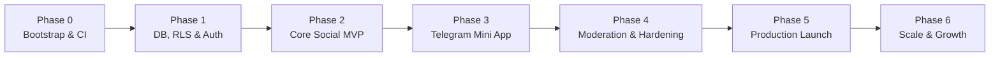

# Ishlab Chiqish Yo‘l Xaritasi (DEVELOPMENT_ROADMAP.md)

Ushbu hujjat **Avero** loyihasini bo‘sh repository’dan xavfsiz, ishlab chiqarishga tayyor (production-ready) Web + Telegram Mini App ijtimoiy tarmog‘iga aylantirish bo‘yicha bosqichma-bosqich rejani belgilaydi.

---

## Bosqichlar Umumiy Ko‘rinishi

---

## Phase 0 — Repository va Loyiha Skeleti (Bootstrap)
**Maqsad:** Toza, standartlashtirilgan, xavfsiz boshlang‘ich kod bazasini yaratish.

- [ ] Git initsializatsiyasi (`git init`), `.gitignore`, `.env.example` yaratish.
- [ ] Next.js (App Router, TypeScript strict) + Tailwind CSS sozlash.
- [ ] Hono API kirish nuqtasini (`/api/v1/[[...route]]`) va `GET /api/v1/health` endpointini qo‘shish.
- [ ] Drizzle ORM + Drizzle Kit sozlash va Neon dev branch’ga ulash.
- [ ] ESLint, Prettier, TypeScript check (`tsc --noEmit`) va Vitest konfiguratsiyasi.
- [ ] GitHub Actions CI pipeline (lint + typecheck + unit test).

**Tugallanish mezoni (DoD):** Ilova lokalda ishga tushadi, `/api/v1/health` DB ulanishini tasdiqlaydi, CI yashil o‘tadi.

---

## Phase 1 — Database Sxemasi, RLS, Autentifikatsiya va Akkaunt Bog‘lash
**Maqsad:** Eng muhim xavfsizlik va identitet qatlamini mustahkam qurish.

- [ ] Barcha asosiy jadvallar uchun Drizzle sxemasi va SQL migratsiyalar (`users`, `auth_identities`, `user_sessions`, `account_link_tokens`, `audit_logs`).
- [ ] `avero_app` (`NOBYPASSRLS`) roli va PostgreSQL **RLS** siyosatlarini migratsiyaga qo‘shish.
- [ ] `withDbContext()` tranzaksiya wrapper’ini yozish va RLS izolyatsiya testlarini qo‘shish.
- [ ] Opaque session tizimi (Web cookie + TMA Bearer token, SHA-256 hash, logout / logout-all).
- [ ] **Google OAuth 2.0 + PKCE** Web autentifikatsiyasi.
- [ ] **Telegram `initData` HMAC-SHA256** verifikatsiyasi va `auth_date` tekshiruvi.
- [ ] **Xavfsiz Google ↔ Telegram bog‘lash** (bir martalik token, `409` conflict himoyasi, unlink cheklovi).
- [ ] `audit_logs` yozish servisi (auth va linking hodisalari).

**Tugallanish mezoni (DoD):** Foydalanuvchi Web’da Google bilan, Telegram’da TMA orqali kira oladi va ikki akkauntni bitta profilga xavfsiz bog‘lay oladi; auth/linking/RLS testlari o‘tadi.

---

## Phase 2 — Asosiy Matnli Ijtimoiy Tarmoq (Core MVP)
**Maqsad:** Web foydalanuvchilari uchun to‘liq matnli ijtimoiy tarmoq funksionalligi.

- [ ] `posts`, `post_likes`, `post_reposts`, `post_bookmarks`, `follows`, `user_blocks` jadvallari, indekslar va RLS siyosatlari.
- [ ] Qat’iy JSON-only + 16 KB limit + Unicode/matn sanitizatsiya middleware.
- [ ] Post va Thread (javoblar) yaratish, ko‘rish, o‘chirish (1–500 belgi, faylsiz).
- [ ] Cursor-based Feed API (`Latest` va `Following` lentalari).
- [ ] Like, Repost, Bookmark (optimistic UI + atomik hisoblagichlar).
- [ ] Foydalanuvchi profili sahifasi (`/u/[username]`), profil tahrirlash (`username`, `displayName`, `bio`), Follow/Unfollow, Block.
- [ ] PostgreSQL Full-Text Search (`/search` — postlar va foydalanuvchilar bo‘yicha).
- [ ] Dynamic OpenGraph metadata (havolalarni ulashganda matn preview).

**Tugallanish mezoni (DoD):** Web saytda to‘liq matnli ijtimoiy tarmoq sikli (kirish → post → javob → like/repost → follow → qidiruv) ishlaydi.

---

## Phase 3 — Telegram Mini App (TMA) Integratsiyasi
**Maqsad:** Mini App ichida nativ, qulay va uzluksiz tajriba yaratish.

- [ ] `@telegram-apps/sdk-react` integratsiyasi va `PlatformProvider` (Web vs TMA).
- [ ] Telegram tema (`themeParams`), dark/light rejim, `safeAreaInset` va `viewport` sinxronizatsiyasi.
- [ ] Nativ `BackButton` va mobil bottom navigation.
- [ ] `startapp` deep-linking (`post_<id>`, `u_<username>`, `link_<token>`).
- [ ] TMA ↔ Web akkaunt bog‘lash UX (QR kod + `openLink` orqali tizim brauzerida Google OAuth).
- [ ] Telegram iOS, Android, Desktop va Telegram Web’da qo‘lda tekshirish.

**Tugallanish mezoni (DoD):** Mini App barcha Telegram mijozlarida xatosiz ochiladi, sessiya saqlanadi va Web bilan bitta profil/kontentda sinxron ishlaydi.

---

## Phase 4 — Moderatsiya, Admin Panel, Rate Limiting va Xavfsizlik Tekshiruvi
**Maqsad:** Tizimni spam, suiiste’mol va xavfsizlik hujumlariga chidamli qilish.

- [ ] `reports` va `moderation_actions` jadvallari + RLS siyosatlari.
- [ ] Shikoyat yuborish UI/API.
- [ ] Moderator paneli (`/mod`): shikoyatlar navbati, post yashirish/tiklash, foydalanuvchini mute/suspend qilish (majburiy sabab + audit log).
- [ ] Admin paneli (`/admin`): moderator rollarini boshqarish, permanent ban/unban, `audit_logs` ko‘rish va filtrlash.
- [ ] Upstash Redis rate limiting (barcha endpoint guruhlari + yangi akkaunt cheklovlari).
- [ ] Security Headers (CSP, HSTS, `frame-ancestors`), CSRF tekshiruvi.
- [ ] Avtomatlashtirilgan xavfsizlik testlari (soxta `initData`, link conflict, RLS bypass urinishi, `multipart/form-data` rad etilishi, RBAC chegaralari).

**Tugallanish mezoni (DoD):** Xavfsizlik cheklistining barcha bandlari avtomatik testlar bilan tasdiqlangan.

---

## Phase 5 — Production Launch va Monitoring
**Maqsad:** Loyihani ommaviy foydalanishga chiqarish.

- [ ] Production domen + Cloudflare DNS/SSL/WAF sozlash.
- [ ] Production Neon DB branch + migratsiya + zaxira nusxa (backup) rejasi.
- [ ] Google OAuth Consent Screen’ni Production holatiga o‘tkazish (Privacy Policy & Terms sahifalari bilan).
- [ ] Telegram BotFather’da Menu Button va Mini App Short Name sozlash.
- [ ] Sentry error tracking + uptime monitoring (`/api/v1/health`).
- [ ] Load/smoke test va rasmiy beta ishga tushirish.

---

## Phase 6 — Post-MVP Kengayish (Growth & Scale)
*(Foydalanuvchilar o‘sgandan so‘ng bosqichma-bosqich qo‘shiladi)*

- [ ] Real-vaqtga yaqin bildirishnomalar (In-app + ixtiyoriy Telegram Bot bildirishnomalari).
- [ ] `#hashtag` va `@mention` ajratib ko‘rsatish va trend mavzular.
- [ ] Redis feed/profile keshlash qatlami.
- [ ] PostgreSQL Read Replica + `audit_logs` / `posts` partitioning.
- [ ] Hybrid fan-out feed worker (100K+ MAU darajasida).
