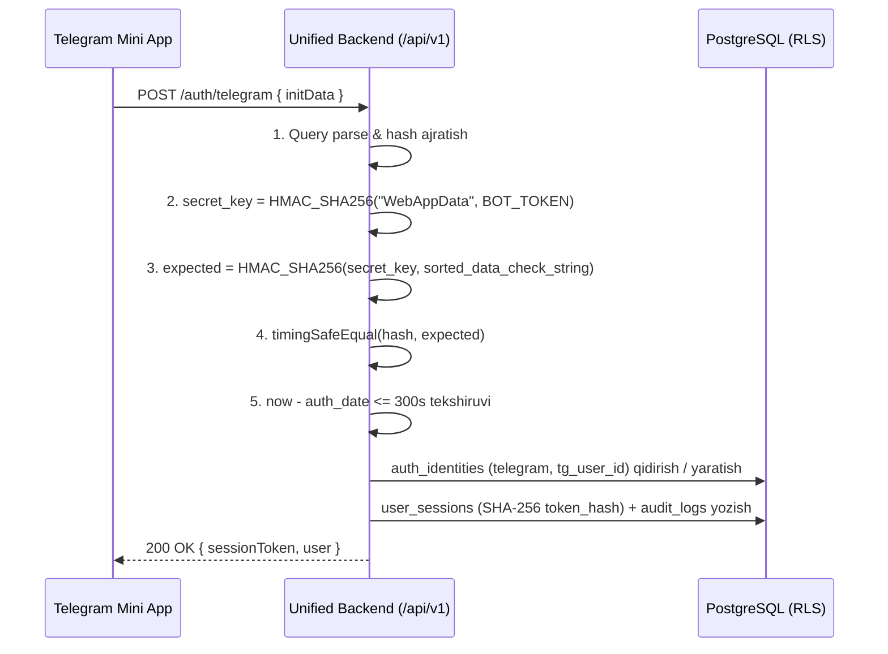
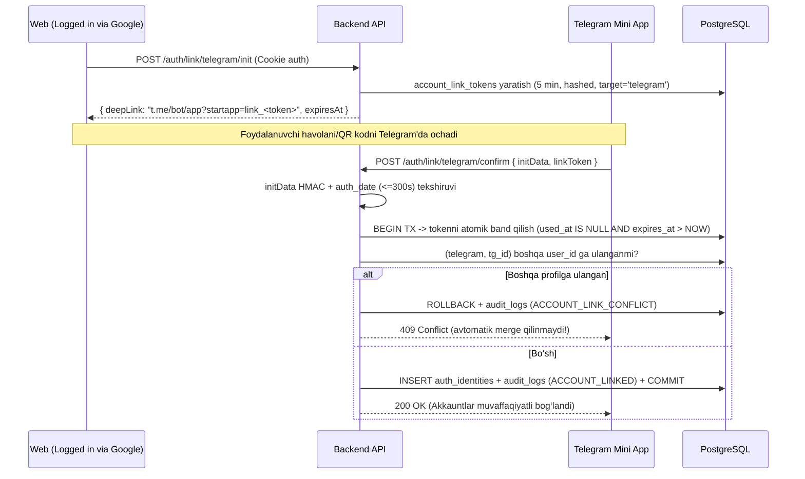

# Xavfsizlik Arxitekturasi (SECURITY.md)

Ushbu hujjat **Avero** tizimining tahdid modeli, autentifikatsiya va akkaunt bog‘lash protokollari, RBAC/RLS himoyasi, matn-cheklovlari, rate limiting va audit loglash standartlarini belgilaydi.

---

## 1. Asosiy Tahdid Modeli (Threat Model)

| Tahdid | Xavf darajasi | Himoya chorasi |
| :--- | :--- | :--- |
| **Telegram `initData` soxtalashtirish** | Kritik | Server tomonda `HMAC-SHA256` tekshiruvi (`WebAppData` + `TELEGRAM_BOT_TOKEN`), `timingSafeEqual`, `auth_date <= 300s` |
| **Akkaunt bog‘lashda egallab olish (ATO)** | Kritik | 5 daqiqalik bir martalik token, atomik iste’mol, `409` conflict (avtomatik merge yo‘q), Google `email_verified=true` talabi |
| **Sessiya o‘g‘irlanishi / CSRF** | Yuqori | Web’da `HttpOnly; Secure; SameSite=Lax` + Origin/CSRF tekshiruvi; DB’da faqat token SHA-256 xeshi; instant revocation |
| **XSS / HTML inyeksiya** | Yuqori | Faqat oddiy matn (raw HTML yo‘q), React auto-escape, qat’iy CSP, `https://` havola allowlist |
| **Media yuklash orqali hujum** | O‘rta | Fayl upload endpointlari umuman yo‘q, `multipart/form-data` rad etiladi (`415`), maksimal payload `16 KB` |
| **Spam / Bot flood / Brute-force** | Yuqori | Cloudflare WAF + Upstash Redis sliding-window rate limiting + yangi akkauntlar uchun qattiqroq limitlar |
| **Privilege Escalation / IDOR** | Kritik | Application RBAC + PostgreSQL `FORCE ROW LEVEL SECURITY` + `avero_app` (`NOBYPASSRLS`) |
| **Audit loglarni o‘chirish/o‘zgartirish** | Yuqori | `REVOKE UPDATE, DELETE, TRUNCATE ON audit_logs FROM avero_app` (append-only) |

---

## 2. Autentifikatsiya Oqimlari

### 2.1. Web — Google OAuth 2.0 + OIDC (PKCE)
1. Foydalanuvchi `GET /api/v1/auth/google/start` ga o‘tadi.
2. Backend kriptografik tasodifiy `state`, `nonce` va PKCE `code_verifier` yaratadi, ularni imzolangan qisqa muddatli (10 daqiqa) `HttpOnly; Secure; SameSite=Lax` cookie’ga yozadi va Google’ga yo‘naltiradi (`scope=openid email profile`).
3. Google callback’da (`GET /api/v1/auth/google/callback`):
   - `state` va cookie qiymati `timingSafeEqual` bilan tekshiriladi.
   - `code` + `code_verifier` orqali token olinadi, ID token’dagi `iss`, `aud`, `exp`, `nonce` va `email_verified === true` tasdiqlanadi.
   - `auth_identities` jadvalidan `(provider='google', provider_user_id=sub)` qidiriladi.
   - Topilmasa yangi `users` + `auth_identities` yaratiladi (yoki agar faol bog‘lash oqimi bo‘lsa, mavjud `user_id` ga ulanadi).
   - 256-bitli opaque sessiya tokeni yaratiladi, SHA-256 xeshi `user_sessions` ga saqlanadi, `HttpOnly; Secure; SameSite=Lax` cookie o‘rnatiladi.
   - `audit_logs` ga `AUTH_LOGIN_GOOGLE` yoziladi.

### 2.2. Telegram Mini App — `initData` Server-Side Verifikatsiya
Frontend hech qachon `initDataUnsafe` ni autentifikatsiya sifatida ishlatmaydi.

**Majburiy qoidalar:**
- `auth_date` 300 soniyadan (5 daqiqa) eski bo‘lsa so‘rov `401 AUTH_DATA_EXPIRED` bilan rad etiladi.
- `TELEGRAM_BOT_TOKEN` faqat server muhitida saqlanadi, client bundle’ga hech qachon kirmaydi.
- Foydalanuvchi `status = 'banned'` bo‘lsa sessiya berilmaydi (`403 ACCOUNT_BANNED`).

---

## 3. Google va Telegram Akkauntlarini Xavfsiz Bog‘lash

Ikkala yo‘nalishda ham bog‘lash **ikki tomonlama tasdiqlangan (authenticated dual-proof)** tarzda amalga oshiriladi.

### 3.1. Oqim A: Web (Google) → Telegram Bog‘lash

### 3.2. Oqim B: Telegram Mini App → Google Bog‘lash
1. TMA foydalanuvchisi `POST /api/v1/auth/link/google/init` (Bearer auth) chaqiradi.
2. Backend 5 daqiqalik bir martalik `link_token` yaratadi va `https://<domain>/auth/link/google?token=<token>` manzilini qaytaradi.
3. TMA `WebApp.openLink(...)` orqali tizim brauzerini ochadi.
4. Server `link_token` mavjudligi va muddatini tekshiradi, uni OAuth `state` cookie’siga bog‘lab Google OAuth 2.0 + PKCE oqimini boshlaydi.
5. Callback’da Google `sub` va `email_verified=true` tasdiqlanadi, `link_token` tranzaksiya ichida bir marta iste’mol qilinadi, conflict bo‘lmasa `auth_identities` ga yoziladi va `ACCOUNT_LINKED` audit logi qayd etiladi.

### 3.3. Akkauntni Uzish (Unlink) va Konflikt Qoidalari
- **Avtomatik birlashtirish (silent merge) taqiqlanadi:** Agar bog‘lanmoqchi bo‘lgan Google yoki Telegram akkaunt allaqachon boshqa profilga ulangan bo‘lsa, tizim `409 ACCOUNT_ALREADY_LINKED` qaytaradi. Bu oldindan egallab olish (pre-hijacking) va ma’lumot sizib chiqishini to‘liq oldini oladi.
- **Oxirgi kirish usulini himoyalash:** Foydalanuvchida faqat 1 ta `auth_identities` qolgan bo‘lsa, `DELETE /api/v1/auth/identities/:provider` `400 LAST_IDENTITY_CANNOT_UNLINK` qaytaradi.
- **Sessiya tozalash:** Biror provayder uzilganda, o‘sha provayder orqali ochilgan barcha `user_sessions` darhol bekor qilinadi.

---

## 4. Ruxsatlar Matritsasi (RBAC + RLS)

| Resurs / Amal | Anonim | `user` | `moderator` | `admin` |
| :--- | :---: | :---: | :---: | :---: |
| Ommaviy feed, post, profil, qidiruv | O‘qish | O‘qish | O‘qish | O‘qish |
| Post yaratish, like, repost, bookmark, follow | — | Ha (faol bo‘lsa) | Ha | Ha |
| O‘z postini o‘chirish / profilini tahrirlash | — | Ha | Ha | Ha |
| Shikoyat (report) yuborish | — | Ha | Ha | Ha |
| Shikoyatlar navbatini ko‘rish va hal qilish | — | — | Ha | Ha |
| Boshqa foydalanuvchi postini yashirish/tiklash | — | — | Ha (sabab bilan) | Ha (sabab bilan) |
| Foydalanuvchini vaqtincha mute/suspend qilish | — | — | Ha (`user` ga) | Ha |
| Foydalanuvchini doimiy ban/unban qilish | — | — | — | Ha |
| `moderator` rolini tayinlash / olib tashlash | — | — | — | Ha |
| To‘liq `audit_logs` ni ko‘rish | — | — | — | Ha |

> **Cheklov:** Moderator boshqa moderator yoki admin hisobiga chora ko‘ra olmaydi.

---

## 5. Server-Side Validatsiya va Text-Only Himoya

1. **Qat’iy JSON-only Middleware:**
   - Barcha mutatsiya so‘rovlarida (`POST`, `PATCH`, `PUT`) `Content-Type: application/json` majburiy.
   - `multipart/form-data`, `application/octet-stream`, `image/*`, `video/*` avtomatik `415 Unsupported Media Type` bilan rad etiladi.
   - Maksimal request body hajmi: **16 KB** (ortig‘i `413 Payload Too Large`).
2. **Matn Sanitizatsiyasi va Validatsiya (Zod):**
   - Barcha matnlar Unicode `NFC` ga normallashtiriladi.
   - Xavfli boshqaruv belgilari (NUL `\u0000`, BiDi/RTL spoofing `\u202E` va h.k.) tozalanadi.
   - Ketma-ket ko‘p bo‘sh qatorlar cheklanadi (ekranni bo‘sh satrlar bilan to‘ldirish spamining oldini olish).
   - Post uzunligi: `1–500` belgi; Bio: `0–160` belgi; Username: `3–30` belgi (`^[a-z0-9_]+$`, band qilingan nomlar ro‘yxati: `admin`, `mod`, `api`, `auth`, `settings`, `support` bloklanadi).
3. **HTTP Xavfsizlik Sarlavhalari (Security Headers):**
   - `Content-Security-Policy`: `default-src 'self'; script-src 'self' https://telegram.org; img-src 'self' data:; object-src 'none'; base-uri 'self'; frame-ancestors https://web.telegram.org https://*.telegram.org` (TMA Web’da ochilishi uchun faqat Telegram domenlariga ruxsat, boshqa saytlarda clickjacking bloklanadi).
   - `Strict-Transport-Security: max-age=31536000; includeSubDomains`
   - `X-Content-Type-Options: nosniff`
   - `Referrer-Policy: strict-origin-when-cross-origin`
   - `Permissions-Policy: camera=(), microphone=(), geolocation=()`

---

## 6. Rate Limiting va Anti-Spam Tizimi

**Upstash Redis** (Sliding Window algoritmi) asosida ishlaydi; lokal muhitda Redis ulanmagan bo‘lsa xotira/DB fallback ishga tushadi.

| Endpoint guruhi | Kalit (Key) | Limit |
| :--- | :--- | :--- |
| `POST /auth/telegram`, `GET /auth/google/*` | IP | 15 so‘rov / 5 daqiqa |
| `POST /auth/link/*` | User ID + IP | 5 so‘rov / 10 daqiqa |
| `POST /posts` (oddiy foydalanuvchi) | User ID | 5 post / daqiqa va 60 post / soat |
| `POST /posts` (yangi akkaunt < 24 soat) | User ID | 2 post / daqiqa va 15 post / soat |
| `POST /*/like`, `repost`, `follow` | User ID | 60 amal / daqiqa |
| `POST /reports` | User ID | 10 shikoyat / soat |
| `GET /search` | User ID yoki IP | 30 so‘rov / daqiqa |
| Umumiy `GET /api/v1/*` | IP | 120 so‘rov / daqiqa |

Limit oshganda `429 Too Many Requests` va `Retry-After` sarlavhasi qaytariladi.

---

## 7. Audit Loglash Siyosati

Quyidagi hodisalar majburiy tarzda `audit_logs` jadvaliga yoziladi:
- **Autentifikatsiya:** `AUTH_LOGIN_GOOGLE`, `AUTH_LOGIN_TELEGRAM`, `AUTH_LOGIN_FAILED`, `AUTH_LOGOUT`, `AUTH_LOGOUT_ALL`
- **Akkaunt bog‘lash:** `ACCOUNT_LINK_INITIATED`, `ACCOUNT_LINKED`, `ACCOUNT_LINK_CONFLICT`, `ACCOUNT_UNLINKED`
- **Profil va xavfsizlik:** `USERNAME_CHANGED`, `USER_BLOCKED`, `RATE_LIMIT_ABUSE`
- **Moderatsiya va Admin:** `POST_HIDDEN`, `POST_RESTORED`, `USER_MUTED`, `USER_SUSPENDED`, `USER_BANNED`, `USER_UNBANNED`, `ROLE_CHANGED`, `REPORT_RESOLVED`

**Maxfiylik qoidasi:** Audit log `metadata` maydoniga hech qachon parol, sessiya tokeni, `initData`, OAuth access/refresh token yoki xom IP manzil yozilmaydi (IP faqat `HMAC-SHA256(AUDIT_IP_SALT, ip)` ko‘rinishida saqlanadi).

---

## 8. Secret Management va Operatsion Nazorat

- Barcha maxfiy kalitlar faqat hosting provayderning Encrypted Environment Variables panelida saqlanadi.
- `.env*` fayllar (`.env.example` dan tashqari) `.gitignore` ga kiritiladi.
- CI bosqichida `secretlint` / `gitleaks` orqali tasodifiy kalit sizib chiqishi tekshiriladi.
- Kalitlar rotatsiya qilinadigan qilib loyihalanadi (`AUTH_SESSION_SECRET`, `TELEGRAM_BOT_TOKEN`, DB parollari).
